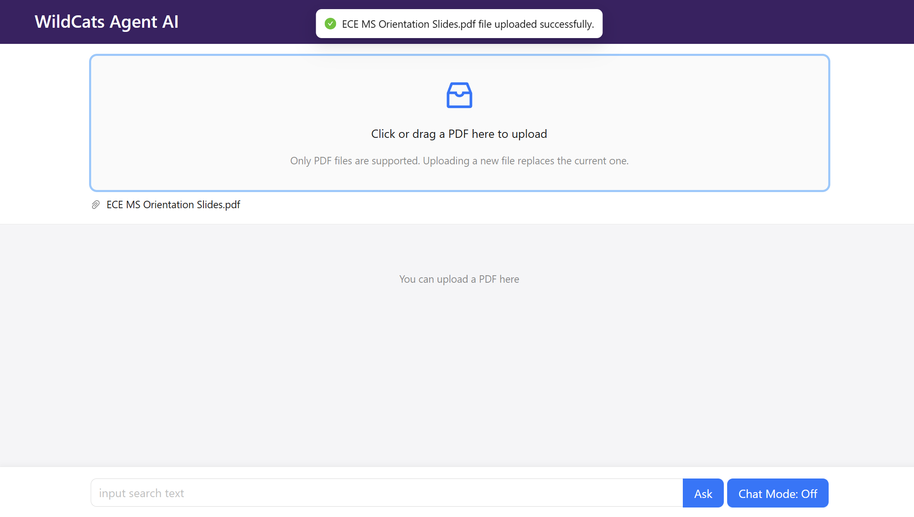
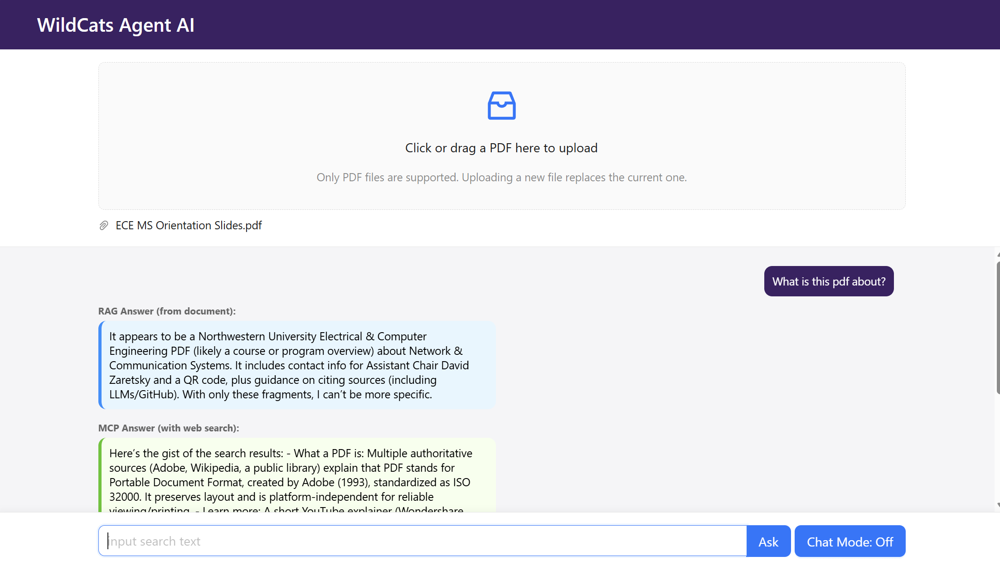
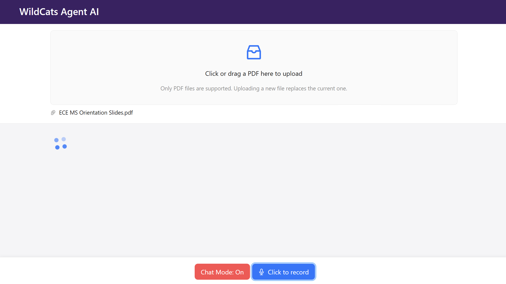

# 🤖 Wildcats Agent AI

An AI assistant that answers questions about your documents **and** the web. Upload a PDF, ask a question, and get two answers side by side: one grounded in the document (RAG) and one based on live Google search results (MCP tool calling). Supports voice input and spoken answers.

## Demo
https://github.com/user-attachments/assets/6c4fdf0f-a213-4954-b3d7-d62d5b4fcd60

## Screenshots

| Upload a PDF | Ask Questions |
|---|---|
|  |  |

| Voice Chat Mode |
|---|
|  |

## Features

- **PDF upload**: drag and drop a PDF to use as the knowledge source
- **RAG answers**: answers grounded in the uploaded document, with the model told to say "I don't know" instead of making things up
- **Web search answers**: an MCP server exposes a `search_web` tool (backed by SerpAPI / Google Search), and the model summarizes the results
- **Side-by-side comparison** of the document answer and the web answer for every question
- **Voice chat mode**: speak your question (speech recognition) and hear the answer read aloud (text-to-speech)

## How It Works

**RAG pipeline** (`server/chat.js`)
1. Load the PDF with LangChain's `PDFLoader`
2. Split it into 500-character chunks
3. Embed the chunks with OpenAI embeddings and store them in an in-memory vector store
4. Retrieve the chunks most relevant to the question
5. Send the retrieved context + question to the LLM with a custom prompt

**MCP web search** (`server/mcp-server.js`, `server/chat-mcp.js`)
1. The backend starts an MCP server as a child process and connects to it over stdio (connection reused across requests)
2. It calls the `search_web` tool, which queries Google through SerpAPI
3. The LLM summarizes the search results into an answer

## Tech Stack

| Layer | Technologies |
|---|---|
| Frontend | React 18, Ant Design, axios, react-speech-recognition, speak-tts |
| Backend | Node.js, Express, Multer (file upload) |
| AI | LangChain, OpenAI (chat + embeddings), Model Context Protocol (MCP) SDK, SerpAPI |

## Project Structure

```
agent-ai/
├── src/                  # React frontend (port 3000)
│   └── components/       # PdfUploader, ChatComponent, RenderQA
└── server/               # Express backend (port 5001)
    ├── server.js         # /upload and /chat endpoints
    ├── chat.js           # RAG pipeline
    ├── chat-mcp.js       # MCP client
    └── mcp-server.js     # MCP server with the search_web tool
```

## API Endpoints

| Method | Path | Description |
|---|---|---|
| POST | `/upload` | Upload a PDF (multipart form, field `file`) |
| GET | `/chat?question=...` | Returns `{ ragAnswer, mcpAnswer }` |

## How to Run Locally

**Prerequisites:** Node.js 18+, an [OpenAI API key](https://platform.openai.com/), a [SerpAPI key](https://serpapi.com/)

**1. Install dependencies**
```bash
npm install
cd server
npm install
```

**2. Add your API keys**

Copy `server/.env.example` to `server/.env` and fill in your keys:
```
OPENAI_API_KEY=your-openai-api-key
SERPAPI_KEY=your-serpapi-key
```

**3. Start frontend and backend together** (from the project root)
```bash
npm run dev
```
Open http://localhost:3000, upload a PDF, and start asking questions.

> Voice mode uses the browser's Web Speech API and works best in Chrome.

## Author

Huizeyuanyang — [GitHub](https://github.com/Huizeyuanyang)
